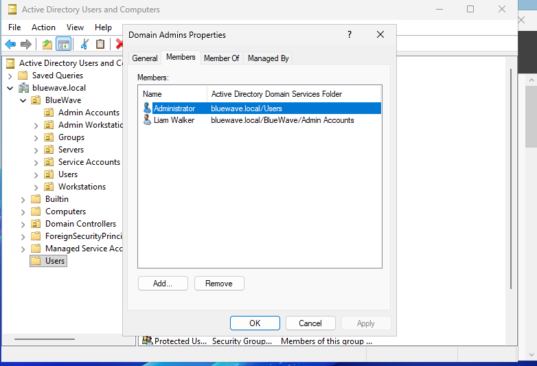
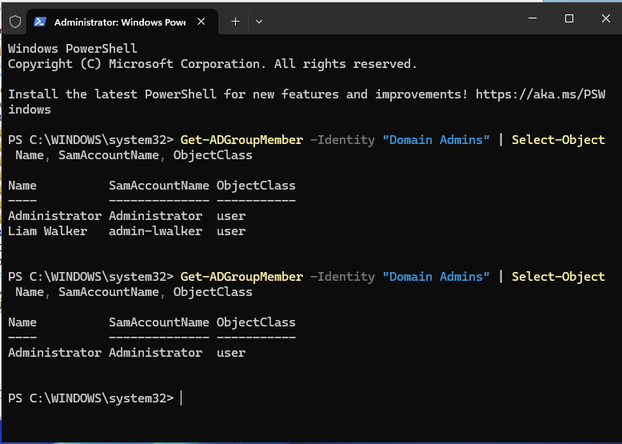

# Active Directory Security Review

## 1. Overview

An Active Directory security review was conducted within the BlueWave Manufacturing cybersecurity lab to assess organisational structure, account separation, privileged group membership and selected account-security configurations.

The assessment focused on identifying excessive privileges and demonstrating risk-based security remediation.

**Environment:** Windows Server 2025, Active Directory Domain Services  
**Domain:** `bluewave.local`  
**Domain Controller:** `DC01`  
**Assessment status:** Completed

## 2. Assessment Scope

The review covered:

- Organisational Units (OUs) and computer placement
- Standard and privileged user accounts
- Departmental security groups
- Membership of privileged Active Directory groups
- Selected user account-security properties

The assessment used PowerShell and Active Directory administrative tools.

## 3. Assessment Results

| Control Area | Observation | Result |
|---|---|---|
| OU organisation | Separate OUs for users, servers, workstations and administrative accounts | Satisfactory |
| Computer placement | DC01, FILESERVER01, CLIENT01 and ADMIN01 located in their designated OUs | Satisfactory |
| Identity separation | `lwalker` and `admin-lwalker` use separate accounts | Satisfactory |
| Standard user permissions | `lwalker` belongs to Domain Users and GG-IT-Users | Satisfactory |
| Privileged access | `admin-lwalker` had standing Domain Admin membership | Remediated |
| Account security | Selected password and Kerberos account flags reviewed for both Liam Walker identities | No adverse settings identified |

## 4. Security Finding — AD-01

**Title:** Excessive Standing Domain Administrator Privileges

**Asset:** Active Directory Domain Services

**Affected identity:** `admin-lwalker`

**Observation:** The administrative account `admin-lwalker` was a permanent member of the built-in Domain Admins group.

**Risk:** Compromise or misuse of this identity could provide an attacker with domain-wide administrative privileges, increasing the potential impact of credential theft and lateral movement.

**Recommended treatment:** Apply least privilege by removing unnecessary standing Domain Admin membership and retaining a separate administrative identity for appropriately delegated administrative duties.

## 5. Remediation Performed

The following corrective action was completed:

1. Reviewed the original Domain Admins membership.
2. Captured pre-remediation evidence.
3. Removed `admin-lwalker` from Domain Admins.
4. Verified the updated group membership.
5. Confirmed that `admin-lwalker` remained a member of `GG-IT-Administrators`.

The account was retained for future administrative delegation without automatic domain-wide privilege through Domain Admins.

## 6. Validation Evidence

**Before remediation**



**After remediation**



Validation command:

```powershell
Get-ADGroupMember -Identity "Domain Admins" |
Select-Object Name, SamAccountName, ObjectClass
```

The post-remediation group membership output confirmed that `admin-lwalker` was no longer a direct member of Domain Admins.

## 7. GRC Significance

This exercise demonstrates:

- Identification of excessive privileged access
- Assessment of identity-related security risk
- Application of least-privilege principles
- Implementation of corrective action
- Collection of before-and-after evidence
- Verification of remediation effectiveness

The finding will be incorporated into the consolidated security risk register and mapped to relevant ISO/IEC 27001, NIST CSF and ASD Essential Eight requirements where applicable.

## 8. Outcome

**Finding AD-01: Remediated**

Unnecessary standing Domain Admin membership was removed from `admin-lwalker`.

Further validation of delegated administrative permissions and effective access controls will be performed when those controls are implemented.

The review demonstrates practical Active Directory administration alongside security governance, risk assessment and remediation.
