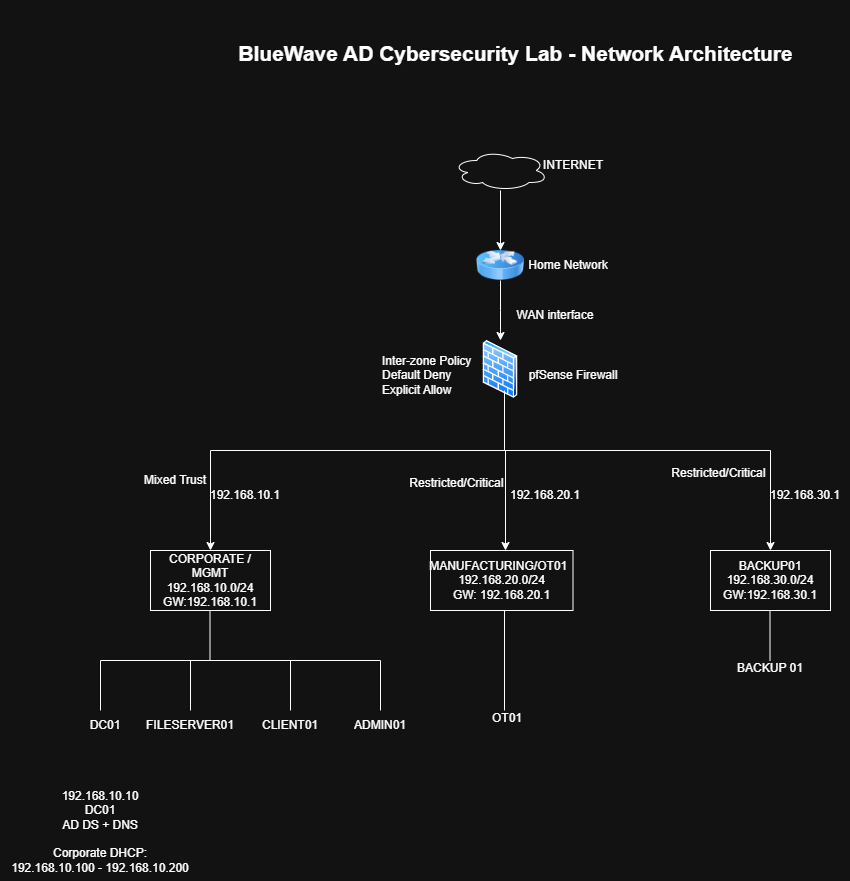

# BlueWave Manufacturing — Active Directory Security & GRC Case Study

**A hands-on cybersecurity governance, risk and compliance portfolio project**, supported by a Windows Active Directory and pfSense home lab.

**Project status:** Seven-phase case study completed. Technical validation and GRC documents are committed; **22 supporting evidence screenshots are committed**.

## Executive Summary

Built a simulated enterprise environment for the fictional Australian manufacturer **BlueWave Manufacturing**, assessed identity and network-access weaknesses, implemented targeted security controls, and documented their effectiveness and residual business risks.

**Results at a glance:**
- Identified and removed unnecessary standing **Domain Admin** access for an administrative identity.
- Strengthened domain password policy from **7 to 14 characters** and enabled **10-attempt account lockout**.
- Validated **Microsoft Defender**, **Windows Firewall**, **Group Policy** and selected Windows audit events on CLIENT01.
- Replaced broad pfSense permissions with restricted IPv4 policies; blocked previously permitted **OT/Backup-to-AD** and **Corporate-to-OT/Backup** test connections.
- Preserved approved lab **DNS/NTP** access for OT01 and BACKUP01.
- Assessed **four business risk scenarios**, documented inherent/residual ratings and treatments, and mapped selected controls to **ISO/IEC 27001:2022**, **NIST CSF 2.0** and **ASD Essential Eight**.

## Architecture

| Zone | Network | Key systems |
|---|---|---|
| Corporate / Management (BWCORP) | `192.168.10.0/24` | DC01, FILESERVER01, CLIENT01, ADMIN01 |
| Manufacturing / OT (BWOT) | `192.168.20.0/24` | OT01 |
| Backup (BWBACKUP) | `192.168.30.0/24` | BACKUP01 |

**Technologies:** Oracle VirtualBox, pfSense, Windows Server 2025, Windows 11, Active Directory Domain Services, DNS, Group Policy, PowerShell and Ubuntu Server/chrony.

See the [architecture overview](02-Architecture/Architecture-Overview.md) and [environment deployment records](03-Environment-Setup/).

## Risk Assessment Outcomes

| Risk | Inherent risk | Provisional residual risk | Key treatment |
|---|---|---|---|
| R-01 — Privileged AD account compromise | High (15) | Medium (8) | Removed unnecessary Domain Admin membership |
| R-02 — Weak authentication controls | High (16) | High (12) | Strengthened default domain account policy |
| R-03 — Corporate/OT lateral movement | Critical (20) | High (10) | Restricted tested IPv4 paths and allowed scoped DNS/NTP |
| R-04 — Backup infrastructure compromise | Critical (20) | High (10) | Segmented tested backup paths; recovery testing still outstanding |

Ratings use a qualitative **5 × 5 likelihood × impact** methodology and are approved for case-study use only. Read the [risk assessment](06-Security-Assessment/Security-Risk-Assessments.md) and [management risk register](07-GRC/Risk-Register.md).

## Evidence-Based Security Work

| Capability | Implementation / assessment |
|---|---|
| Active Directory administration | [AD implementation](04-Active-Directory/AD-Implementation.md) |
| Privileged access assessment and remediation | [AD security review](04-Active-Directory/AD-Security-Review.md) |
| Domain and endpoint security baselines | [GPO security hardening](05-Security-Controls/GPO-Security-Hardening.md) |
| Risk-based network segmentation | [Before/after firewall testing](05-Security-Controls/Network-Segmentation.md) |
| Security governance and risk reporting | [Security risk assessment](06-Security-Assessment/Security-Risk-Assessments.md) · [Risk register](07-GRC/Risk-Register.md) |
| Framework control alignment | [Control mapping](07-GRC/Control-Mapping.md) |

The [Evidence directory](Evidence/) contains **22 committed screenshots**: [Active Directory](Evidence/Active-Directory/), [GPO](Evidence/GPO/) and [Network](Evidence/Network/). Relevant screenshots are linked from the corresponding implementation and security review documents. Evidence represents selected lab configurations and tests, not comprehensive production assurance.

## Project Navigation

| Phase | Files |
|---|---|
| 01 — Planning | [Scope](01-Planning/Project-Scope.md) · [Security objectives](01-Planning/Security-Objectives.md) · [Threat model](01-Planning/Threat-Model.md) · [Limitations](01-Planning/Lab-Limitations.md) |
| 02 — Architecture | [Architecture overview](02-Architecture/Architecture-Overview.md) |
| 03 — Environment | [pfSense](03-Environment-Setup/pfSense-Setup.md) · [Servers](03-Environment-Setup/Windows-Server-Setup.md) · [Clients](03-Environment-Setup/Windows-Client-Setup.md) · [OT/Backup](03-Environment-Setup/Restricted-Zone-Systems.md) |
| 04 — Active Directory | [Implementation](04-Active-Directory/AD-Implementation.md) · [Security review](04-Active-Directory/AD-Security-Review.md) |
| 05 — Security Controls | [Group Policy](05-Security-Controls/GPO-Security-Hardening.md) · [Segmentation](05-Security-Controls/Network-Segmentation.md) |
| 06 — Security Assessment | [Risk assessment](06-Security-Assessment/Security-Risk-Assessments.md) |
| 07 — GRC | [Risk register](07-GRC/Risk-Register.md) · [Framework control mapping](07-GRC/Control-Mapping.md) |

## Open Risks and Next Steps

The assessed network controls cover **selected IPv4 traffic**, not all possible connectivity. IPv6 segmentation, authorised maintenance and backup-transfer access, MFA/privileged protections, OT patching and **backup restoration testing** remain unassessed or unfinished. The [risk register](07-GRC/Risk-Register.md) describes proposed owners and treatment actions.

## Skills Demonstrated

**GRC:** security assessments, risk scoring, residual risk analysis, treatment planning, control effectiveness testing, audit evidence traceability, governance reporting, framework mapping.

**Supporting technical skills:** Windows Server/AD administration, IAM and privileged groups, GPO implementation, PowerShell validation, pfSense rule design, segmentation testing, DNS/NTP, troubleshooting.

---

*BlueWave Manufacturing Pty Ltd is fictional. The environment contains no actual customer data or production infrastructure.*
